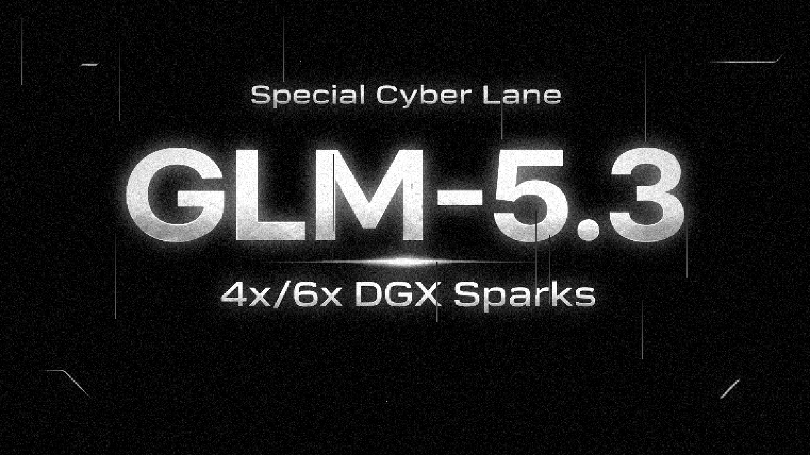

<h1 align="center">GLM-5.3 for DGX Sparks /w DERISKED (Cyber) Lane</h1>

<p align="center">
  
</p>

<p align="center">
  <sub>by <a href="https://x.com/MiaAI_lab">Mia's AI Lab</a></sub>
  <br><br>
  <a href="https://github.com/sponsors/MiaAI-Lab" target="_blank" rel="noopener noreferrer" style="display:inline-block;margin:0 8px;vertical-align:middle;"></a>
  <a href="https://x.com/MiaAI_lab" target="_blank" rel="noopener noreferrer" style="display:inline-block;margin:0 8px;vertical-align:middle;"></a>
</p>

Serve GLM-5.3 on four DGX Sparks (GB10) joined by a switch on their ConnectX-7 ports, or on six, with the
[TensorFold](https://github.com/ashhart/TensorFold) native CUDA engine at tensor-parallel 4 (or 6). The default checkpoint
is wrldsuksgo2mars's K4 EXL3 4-bit quant. The **DERISKED (Cyber) lane** serves Mia's AI Lab's
[`GLM-5.3-DERISKED-Cyber-EXL3-4bpw`](https://huggingface.co/Mia-AiLab/GLM-5.3-DERISKED-Cyber-EXL3-4bpw) with the same
settings (`MODEL_FORMAT=derisked`). The checkpoint lives on spark1 only; the other Sparks read it over a read-only NFS
mount, so nothing is copied to them.

```
spark1  rank 0: the OpenAI-compatible API, the NFS server for the weights
spark2  rank 1 ┐
spark3  rank 2 ├ workers: mount spark1's checkpoint read-only over NFS
spark4  rank 3 ┘
```

What you get with `./start.sh`:

- **The checkpoint:** `GLM-5.3-EXL3-K4`, wrldsuksgo2mars's K4 quant
  ([`wrldsuksgo2mars/GLM-5.3-EXL3-K4-MC`](https://huggingface.co/wrldsuksgo2mars/GLM-5.3-EXL3-K4-MC) at revision `e28931c9`, its
  `original` view): GLM-5.3 with EXL3 4-bit routed experts and a BF16 dense core packed to 8 bits at load. `MODEL_FORMAT=derisked` serves the DERISKED lane instead (EXL3 4 bpw routed experts on the mul1 codebook, BF16
  dense, attention and shared-expert weights packed to 8 bits at load). Either takes about 110 GiB a rank at TP4.
- **A 262,144-token window**, one stream, 8-bit KV (int8 codes), with 4 GiB of memory kept free on every Spark. Six Sparks
  (`TP6_RANKS=6 ./start-tp6.sh`) serve four streams from one 847,872-token shared KV pool.
- **Inco AI's DFlash2 drafter** for speculative decoding. Drafts only propose: replies are the same with drafts on or off.
- **The engine:** TensorFold at a pinned commit plus this repository's 231 patches (`patches/engine/`, numbered 0001–0242),
  built into one Docker image that every rank runs.

## Performance

The K4 rows were measured with `GLM-5.3-EXL3-K4-v1`, which has the same K4 experts as today's `GLM-5.3-EXL3-K4` (K4-MC) but
kept GLM-5.3's FP8 dense core; K4-MC's BF16 core is packed to 8 bits at load, as Derisked's is. Not re-measured yet.

### TP4 (four Sparks)

One stream, measured with [sparkDash](https://github.com/MiaAI-Lab/sparkDash), 294,912-token window (3 GiB reserve), the unified and neon
optimizations on, GPU clocks ~2,190 MHz (2026-11-25).

**Prefill**, tok/s (time to first token):

| prompt | 2K | 4K | 8K | 16K | 32K | 64K | 128K | 256K |
| --- | --- | --- | --- | --- | --- | --- | --- | --- |
| **K4** (default) | 1,571 (1.7 s) | 1,441 (3.2 s) | 1,404 (6.2 s) | 1,384 (12.2 s) | 1,366 (24.4 s) | 1,342 (49.2 s) | 1,301 (101.2 s) | — |
| **Derisked** (DERISKED lane) | 1,582 (1.7 s) | 1,433 (3.2 s) | 1,399 (6.2 s) | 1,378 (12.3 s) | 1,365 (24.4 s) | 1,338 (49.3 s) | 1,278 (102.9 s) | 1,233 (213.0 s) |

**Decode** with DFlash2, tok/s (time to first token):

| | K4 (default) | Derisked (DERISKED lane) |
| --- | --- | --- |
| prose (temperature 0.7, top_k 20, thinking on) | **38.8** (0.31 s) | **38.9** (0.31 s) |
| prose at 64K tokens of context | **33.3** (3.54 s) | **35.6** (3.46 s) |
| code | **52.5** (0.40 s; temperature 0, thinking off) | **45.8** (0.39 s; temperature 0.7, thinking on) |

The code rows ran with different sampling settings, so they do not compare with each other. Every optimization in the
stack keeps replies bit-identical to the build without it (checked on both checkpoints; see
the [changelog](CHANGELOG.md)).

### TP6 (six Sparks)

`TP6_RANKS=6 ./start-tp6.sh` (K4) or `TP6_RANKS=6 MODEL_FORMAT=derisked ./start-tp6.sh`, measured with sparkDash:
868,352-token shared KV pool (3 GiB reserve), four streams, the unified and neon optimizations on, GPU clocks ~2,190 MHz
(2026-11-25). The defaults are now 847,872 tokens at a 4 GiB reserve.

**Prefill**, tok/s (time to first token):

| prompt | 2K | 4K | 8K | 16K | 32K | 64K | 128K | 256K |
| --- | --- | --- | --- | --- | --- | --- | --- | --- |
| **K4** (default) | 1,741 (1.5 s) | 1,598 (2.9 s) | 1,556 (5.6 s) | 1,535 (11.0 s) | 1,511 (22.0 s) | 1,484 (44.5 s) | 1,440 (91.3 s) | 1,387 (189.3 s) |
| **Derisked** (DERISKED lane) | 1,767 (1.4 s) | 1,573 (2.9 s) | 1,540 (5.6 s) | 1,516 (11.1 s) | 1,486 (22.3 s) | 1,463 (45.1 s) | 1,388 (94.8 s) | 1,308 (200.7 s) |

**Decode** with DFlash2, prose (temperature 0.7, top_k 20, thinking on), by concurrent streams. Aggregate tok/s, then per
stream and time to first token:

| streams | 1 | 2 | 3 | 4 |
| --- | --- | --- | --- | --- |
| **K4** (default) | **49.1** (49.1, 0.26 s) | 59.8 (30.8, 0.41 s) | 67.3 (24.1, 0.54 s) | **76.4** (20.1, 0.68 s) |
| **Derisked** (DERISKED lane) | **49.3** (49.3, 0.24 s) | 56.0 (28.8, 0.42 s) | 69.2 (24.5, 0.55 s) | **73.5** (19.3, 0.69 s) |

## KV cache

8-bit KV (int8 codes) costs about 50 KB a token **on every rank**: the latent rows are not split across ranks, so more
Sparks free weight memory for KV but do not divide it. The defaults, with 4 GiB kept free on every Spark:

| | start | KV window | KV a rank | streams | left after the 4 GiB reserve |
| --- | --- | --- | --- | --- | --- |
| **TP4** (four Sparks) | `./start.sh` | **262,144** tokens | ~12.5 GiB | 1 | ~0.7 GiB |
| **TP6** (six Sparks) | `TP6_RANKS=6 ./start-tp6.sh` | **847,872** tokens, one pool shared by the streams | 40.4 GiB | up to 4 | 1.3 GiB |

Both rows hold for Derisked and K4. At TP6 one stream can use the whole pool, or four streams share it (about 212K
tokens each if all four are long). The engine's startup line reports the window, the KV size and what is left
(`logs/current/rank0.log`). `KV_SPLIT=1` at TP4 keeps each token's rows on one rank instead: 540,672 tokens on K4, about
10% slower, one stream.

## Quick start

You need four DGX Sparks on one switch (their ConnectX-7 ports on one RoCE subnet), key-based ssh from spark1 to the
other three, Docker with the NVIDIA runtime on all four, and an NFS server on spark1.

1. **Clone this repository on spark1** and name the workers:

   ```bash
   cp scripts/local.sh.example scripts/local.sh   # set WORKER, WORKER2, WORKER3 to spark2, spark3, spark4; PORT
   ```

2. **Put the checkpoint on spark1 and export it to the workers**, read-only.
   - **K4 (default):** the first start downloads `wrldsuksgo2mars/GLM-5.3-EXL3-K4-MC` at the pinned revision into
     `~/.cache/huggingface/hub/models--wrldsuksgo2mars--GLM-5.3-EXL3-K4-MC`. Only the files of its `original` view are
     fetched (99 shards and its config, about 418 GB); the repository's k8/k6-compact cores are skipped (this engine
     cannot load them). Export that directory.
   - **DERISKED lane** (`MODEL_FORMAT=derisked`): the first start downloads it into `DERISKED_DIR` (default
     `~/models/GLM-5.3-Derisked-EXL3-4bpw`, about 390 GiB) at a pinned revision. Export that directory.

   ```bash
   # /etc/exports on spark1; use your ConnectX-7 subnet
   /home/<you>/.cache/huggingface/hub/models--wrldsuksgo2mars--GLM-5.3-EXL3-K4-MC 10.80.0.0/16(ro,no_subtree_check)
   /home/<you>/models/GLM-5.3-Derisked-EXL3-4bpw 10.80.0.0/16(ro,no_subtree_check)   # the DERISKED lane
   sudo exportfs -ra
   ```

3. **Start, test, stop:**

   ```bash
   DRY_RUN=1 ./start.sh   # print the plan and every rank's command; changes nothing
   ./start.sh             # checks, image, weights, four ranks, smoke test (MODEL_FORMAT=derisked ./start.sh for DERISKED)
   ./stop-tp6.sh          # stop every rank and archive their logs
   ```

The first start builds the image on spark1 and copies it to the workers, then every rank hashes the checkpoint once.
Later starts take a few minutes. `./start.sh restart` replaces a running server.

## Other checkpoints

`MODEL_FORMAT` picks the checkpoint. An exported variable always wins over a format's defaults, and naming a checkpoint
directly with `MODEL_DIR` or `HF_CACHE_DIR` serves it with no format defaults.

| `MODEL_FORMAT` | checkpoint | Sparks |
| --- | --- | --- |
| `k4` (default) | `GLM-5.3-EXL3-K4`: [`wrldsuksgo2mars/GLM-5.3-EXL3-K4-MC`](https://huggingface.co/wrldsuksgo2mars/GLM-5.3-EXL3-K4-MC), `original` view (downloaded) | 4 or 6 |
| `derisked` (the DERISKED lane) | [`Mia-AiLab/GLM-5.3-DERISKED-Cyber-EXL3-4bpw`](https://huggingface.co/Mia-AiLab/GLM-5.3-DERISKED-Cyber-EXL3-4bpw) | 4 or 6 |
| `nvfp4` | [`nvidia/GLM-5.3-NVFP4`](https://huggingface.co/nvidia/GLM-5.3-NVFP4), NVIDIA's ModelOpt NVFP4 quant | 6 (`./start-tp6.sh`) |
| `exlr8` | a gr8 (EXLR8) quant you prepare yourself (below) | 4 |

`./start.sh` adds the serving defaults above (window, reserve, the optimization stack) for `k4` and `derisked`. Other
formats start with the recipe's general defaults; `./start-tp6.sh` runs six Sparks (set `WORKER4` and `WORKER5` too).

## gr8 (EXLR8) quants: supported, not bundled

The engine and the scripts can run GLM-5.3 quants in kindlingai's EXLR8 format (exlr8-v2, the gr8 quants). This recipe
does not bundle one: no EXLR8 checkpoint is in this repository, none is downloaded by `./start.sh` or `./start-tp6.sh`,
and neither starts one unless you prepare it and ask for it with `MODEL_FORMAT=exlr8`.
Matt Mastracci (kindlingai) authored the EXLR8 format (exlr8-v2), the MIT-licensed reference loader and both releases.
[EXLR8 model repository](https://huggingface.co/kindlingai/glm-5.3-exlr8-k2-k3-k4) · [Reference loader](https://github.com/kindlingai/exlr8)

To run one, stop the server, convert it on the four Sparks (each converts its own rank), then start it:

```bash
./stop-tp6.sh
EXLR8_RELEASE=v07 scripts/prepare-exlr8.sh --convert     # or EXLR8_RELEASE=up1
MODEL_FORMAT=exlr8 EXLR8_RELEASE=v07 ./start-tp6.sh
```

The converter recognizes kindlingai's published GLM-5.3 releases by revision (`up1` at `a36ae468`, v0.7 / `bit400` at
`9e25c28a`). Each Spark fetches the ranges its rank needs from kindlingai's Hugging Face repository, or links a complete
local copy you name with `EXLR8_SRC`. `scripts/prepare-exlr8.sh --help` lists the rest (disk space per rank,
`EXLR8_DENSE=native`, `EXLR8_WORKER_HOME`). Engine patches 0205 and 0212–0214 carry the EXLR8 support.

CC BY 4.0 applies only to the packing, manifests and error tables. The weights remain under the GLM-5.3 license.
The EXLR8 format and reference loader are separate works. The three ExLlamaV3-derived primitives retain their MIT terms.
[EXLR8 model card](https://huggingface.co/kindlingai/glm-5.3-exlr8-k2-k3-k4/blob/main/README.md#licence) · [Notices](NOTICE.md)

## What the start does

1. **Config checks:** distinct worker ssh targets, ports, serving settings.
2. **Node checks:** aarch64, Docker, the NVIDIA runtime, a GB10, memory and disk on every Spark.
3. **Image:** builds `tensorfold-glm53nvfp4-spark:<patches hash>` on spark1 and loads it on each worker (skipped when
   the hashes already match).
4. **Fabric:** finds each rank's ConnectX-7 address on the route to rank 0, its netdev and its RDMA devices (a Spark's
   QSFP port shows up as two netdevs and two HCAs; all of them go to NCCL and the engine's RoCE path).
5. **Weights:** creates read-only Docker NFS volumes on the workers and checks each can read `config.json` before any
   rank starts.
6. **Fingerprint:** every rank must report the same checkpoint and the same serving settings before rank 0 opens the port.
7. **Launch:** the workers first, then rank 0 with the API, then a smoke test.

## Settings that matter

Every setting and its default is in `scripts/config.sh`; your overrides go in `scripts/local.sh` or the environment.

| setting | default | what it does |
| --- | --- | --- |
| `MODEL_FORMAT` | `k4` | the checkpoint (see "Other checkpoints") |
| `CONTEXT` | `262144` from `./start.sh` (K4, Derisked); six Sparks (K4, Derisked) `847872`; otherwise K4 `212992`, EXLR8 `196608`, `auto` | the window. Change it by arithmetic (about 50 KB a token a rank), not by probing |
| `MEMORY_RESERVE_GIB` | `4` | memory each Spark keeps free beyond the model and the window |
| `NEON_STACK` | `1` | the unified and neon optimization switches (see "The engine patches"), set by `./start.sh` for K4 and Derisked and by `./start-tp6.sh` for every format; `0` turns them all off |
| `DRAFTER` | `dflash2` | Inco AI's DFlash2; `dspark` Red Hat AI's DSpark speculator; `mtp` the checkpoint's MTP head, where it has one; `none` |
| `KV` / `KV8_CODES` | `fp8` / `int8` | 8-bit KV with int8 codes and two power-of-two scales a row (row error 0.96%); `KV=bf16` opts out |
| `KV_SPLIT` | `0` | `1`: each token's KV rows on one rank, 2.5x the window, about 10% slower |
| `SLOT_RESUME` | `1` | a new prompt on the same slot resumes where the previous prompt still matches (agent loops) |
| `SHARED_KV` / `PARALLEL` | six Sparks `1` / `4`; four Sparks `0` / `1` | streams at once on one shared KV pool (see "Concurrency") |
| `THINKING` | `0` | the default thinking mode; requests can override it |
| `DENSE` / `HEAD` | `q8` / `q8` | dense layers and LM head at int8 (head KL 0.0004 against BF16) |
| `SPLIT_QKVA`, `DSA_INDEX_FAST`, `PF_EXPERTS_ONCE`, `PF_QMMF2`, `PF_DOWN_FUSE` | `1` | exact speedups (see "The engine patches"); `0` opts out of each |
| `MEMGUARD` / `MEMGUARD_FLOOR_GIB` | `1` / `2` | stop the server before a Spark runs out of memory |
| `WORKER_WEIGHTS` | `nfs` | `check` requires each worker's own copy instead |
| `RANK_EXTRA_ENV` | empty | extra engine variables for every rank |

## Memory

GB10 memory is shared with the host, and an overshoot thrashes a Spark until the kernel's OOM killer acts, which can
take ten minutes. The start sizes everything from each Spark's `MemAvailable`:

- At the defaults the engine reports 0.7 GiB (four Sparks) or 1.3 GiB (six) left after the 4 GiB reserve on the
  tightest rank; an idle six-Spark server leaves every Spark 4.6 GiB available or more. A 3 GiB reserve left too little:
  a 2.9 GiB process on spark1 took an idle server under the guard's floor. Keep heavy work off spark1 while it serves.
- Change the window by arithmetic: at 8-bit KV a token costs about 50 KB a rank. `CONTEXT=auto` probes by trying
  larger windows, and without a KV split the kernel kills a rank instead of the engine refusing, so do not use it here.
- The memory guard (`MEMGUARD=1`) stops the server when a Spark stays under 2 GiB available. If it fires, raise
  `MEMORY_RESERVE_GIB` or lower `CONTEXT`.
- There is no prompt cache at the default window; slot resume covers agent loops instead.

## The engine patches

`patches/engine/` applies 231 patches (numbered 0001–0242) to TensorFold commit `f350cd3e`; their hash is part of the image tag. The ones that
matter most for this checkpoint:

- **GLM-5.3 support** (0122–0124, 0132): the `glm_moe_dsa` model (DSA sparse attention, MLA, the indexer), NVIDIA's
  ModelOpt names and FP8 dense layers.
- **Prefill** (0138–0145, 0175–0179, 0206–0208, 0215): prompt exchanges by reduce-scatter, chunks in two halves with the
  exchange under the other half's compute, the msa2 sparse-attention kernel, EXL3 prompt experts read once a chunk, and
  the mul1 codebook's fast prompt kernels.
- **Decode** (0140, 0146–0153, 0192, 0216): RoCE gathers instead of NCCL for decode, L2 prefetches, the decode indexer's RoPE
  hoist and multi-CTA top-2048 (+13% decode at 190K tokens), and the mul1 decode kernels.
- **8-bit KV** (0162–0164), **KV split** (0187–0189), **slot resume** (0195), **concurrency** (0210–0211).
- **Drafters:** DSpark (0165–0173, 0181–0182) and DFlash2 for full GLM-5.3 (0184–0185), including drafts of the tokens a
  request's tool list forces inside a tool call.
- **Quality fix** (0183): full GLM-5.3 has no SwiGLU clamp. Before it, every MLP clamped at GLM-5.3-Flash's limit of 10;
  removing it took K4's top-1 agreement with BF16 from 90.45% to 93.06% (full KL 0.126 to 0.069).
- **Unified and neon stacks** (0218–0234, 0238–0242): per-request policy bits and boot switches, each kept only if every
  reply stayed bit-identical. Against the stack before them, prefill +9–12% and decode +1–12% (Derisked and K4). See
  the [changelog](CHANGELOG.md).
- **Upstream backports** (0235–0237) and **six-Spark work** (0239–0242: even expert split at TP6, DFlash2 split across ranks).

The [changelog](CHANGELOG.md) has every patch, with its measurements.

## Slot resume (agent loops)

With no prompt cache, an agent loop would prefill its whole conversation again every turn. Slot resume (`SLOT_RESUME=1`)
starts a new prompt on the same slot where the slot's previous prompt rows still match: the longest common prefix, cut
back to a 4,096-row chunk boundary, and with DFlash2 a drafter window short of it. Nothing is copied and no memory is set
aside. On K4, a 12-turn agent loop's time to first token went from 33–53 s to 3–7 s a turn, and cold and resumed
replies were identical. Reused rows are reported as `cached_tokens`.

## Concurrency

Several streams share **one KV pool** the size of a single window (patch 0210, `TF_GLM_SEQ_GROW`): each stream's KV rows and
index keys take granules of the pool only as far as its prompt and reply reach, so one stream alone still gets the whole
window. Their decode rows share one verify window a round (patch 0211, `TF_GLM_DSA_SHARED`). Each stream past the first
costs about 48 MiB. Replies are identical to the same request served alone.

- **Six Sparks (`./start-tp6.sh`, K4 or Derisked): on by default**, `SHARED_KV=1` with `PARALLEL=4` and an
  **847,872-token pool** (the window), 1.3 GiB left after the 4 GiB reserve. Derisked at TP6 with an 868,352-token pool and
  a 3 GiB reserve (2026-11-25): a needle in an 800,672-token prompt is found, with every Spark at 3.48 GiB available or more; four greedy prompts of 384 tokens give
  46.4 tok/s a stream alone and **64.5 tok/s aggregate at four streams** (16-27 tok/s each), 4 of 4 replies identical to
  their solo replies.
- **Four Sparks:** off by default, because spark1 has little memory to spare at the four-Spark window. `SHARED_KV=1
  PARALLEL=2 ./start.sh` turns it on; on K4 at TP4 it measured 36.7 tok/s at one stream, 44.7 aggregate at two and 54.8
  at four. Every rank must have about 3 GiB available beyond the window (`TF_GLM_SEQ_GROW_FLOOR_MIB`).

It requires `KV_SPLIT=0`, `KV_PAGES=off` and no prompt or host cache, which `prepare.sh` checks. `SHARED_KV=0` serves one
stream.

## Known limits

- **One stream by default on four Sparks.** Memory on spark1 is the limit (see "Memory"); six Sparks serve four.
- **Switch only.** All Sparks must share one RoCE subnet.
- **`KV_SHARD=1` is TP2-only** in this engine; leave it unset.
- **Six Sparks are not an upstream-supported width.** They work here (`./start-tp6.sh`), mainly for `nvfp4`.

## License

Apache-2.0 for the recipe (see LICENSE). CREDITS.md and NOTICE.md carry the upstream and tooling
credits, including TensorFold (github.com/ashhart/TensorFold) and the Flash recipe this is modeled on.
The checkpoints belong to their authors and are governed by their own terms (see "Models" below).

## Credits

This recipe is by [Mia's AI Lab](https://huggingface.co/Mia-AiLab) ([MiaAI-Lab](https://github.com/MiaAI-Lab)). Full details,
patch by patch, are in [CREDITS.md](CREDITS.md); licences and notices are in [NOTICE.md](NOTICE.md).

**Engine.** [TensorFold](https://github.com/ashhart/TensorFold) by Ash Hart ([@ashhart](https://github.com/ashhart)) and its
contributors: the engine, its CUDA kernels, the DFlash2 drafter code, the RoCE gather and the API. The native EXL3 experts build on
[@justincasey](https://github.com/justincasey)'s [#837](https://github.com/ashhart/TensorFold/pull/837).

**Patches by MiaAI-Lab** ([MiaAI-Lab](https://github.com/MiaAI-Lab), written for this recipe and the lab's earlier
recipes; every patch not listed under other authors below):

| Patches | What |
|---|---|
| 0001–0091 (minus 0013, 0026–0029, 0049–0056) | The GLM-5.3-Flash engine stack of the lab's [2x RTX PRO 6000](https://github.com/MiaAI-Lab/GLM-5.3-Flash-2x-RTX-PRO-6000-TensorFold) and [DGX Spark](https://github.com/MiaAI-Lab/GLM-5.3-Flash-DGX-Sparks-1104) recipes, including DFlash2 on paired prompt chunks (0057–0063) and the decode attention and index work (0067–0091) |
| 0094–0108, 0111–0112, 0115–0119 | The move to GB10: 4,096-row prompt chunks, the two-host launch and links, memory accounting |
| 0122–0123, 0125–0136 | GLM-5.3 (`glm_moe_dsa`): DSA sparse attention, MLA, the indexer, rope, the index-key ring |
| 0137–0153 | Six Sparks: even expert split, reduce-scatter prompt exchanges, two-halves chunks, RoCE decode gathers, the msa2 kernel port, L2 prefetches, the indexer rope fix |
| 0154–0164 | 8-bit KV (FP8 and int8 codes) on the 576-wide latent rows |
| 0165–0173, 0181–0182 | The DSpark drafter in Zig, tool-list drafts, the sharded embedding |
| 0175–0179 | K4 prefill: bf16 slot rows, EXL3 experts once a chunk, coalesced msa2 keys |
| 0183 | The SwiGLU clamp fix for full GLM-5.3 |
| 0184–0185 | Inco AI's DFlash2 on `glm_moe_dsa` |
| 0186–0195 | Release fixes, KV split, the decode indexer speedup, per-request policy, owner rows, slot resume |
| 0205–0216 | EXLR8 support, prefill switches, concurrency (shared KV pool, shared verify windows), the mul1 codebook kernels |
| 0217–0234, 0238–0242 | The unified and neon optimization stacks and the six-Spark waves (balanced expert sharding, split DFlash2) |

**Patches by other authors** (carried with their names in each patch's `From:` line):

| Patches | Author | Source |
|---|---|---|
| 0013, 0028-0029 | Adam Hillson ([@BadAd84](https://github.com/BadAd84)) | [#1623](https://github.com/ashhart/TensorFold/pull/1623), [#1534](https://github.com/ashhart/TensorFold/pull/1534) |
| 0026-0027 | [@ajensenwaud](https://github.com/ajensenwaud) | [#1505](https://github.com/ashhart/TensorFold/pull/1505) |
| 0049-0056 | [@Bizuayeu](https://github.com/Bizuayeu) | [#1423](https://github.com/ashhart/TensorFold/pull/1423) |
| 0092-0093 | [@SvangenStudios](https://github.com/SvangenStudios) | [DeepSeek recipe #31, #28](https://github.com/MiaAI-Lab/DeepSeek-V4.1-Flash-1017-4x-DGX-Sparks-TensorFold/pull/31) |
| 0109-0110 | Cameron Basham | DFlash2 drafter MLP split across every rank; a port of [#1823](https://github.com/ashhart/TensorFold/pull/1823)'s adaptive prompt chunk (`TF_GLM_CHUNK_SOLO`) |
| 0113-0114, 0236 | Robert Wojciechowski ([@wojo](https://github.com/wojo), X [@rwojo](https://x.com/rwojo)) | [#1411](https://github.com/ashhart/TensorFold/pull/1411), [#1431](https://github.com/ashhart/TensorFold/issues/1431) |
| 0120-0121 | Peter Jurik ([@wagzee](https://github.com/wagzee)) | `TF_EXTRA_EOS` (extra end-of-reply tokens) and `TF_THINK_OFF_SPLIT` |
| 0124 | Devin (Cognition's coding agent) | `glm_moe_dsa`'s backbone graph, rope table and NVIDIA NVFP4/FP8 load |
| 0235 | [@devopsfortunato](https://github.com/devopsfortunato), backported by [@laidick](https://github.com/laidick) | [#2276](https://github.com/ashhart/TensorFold/pull/2276), [Flash recipe #20](https://github.com/MiaAI-Lab/GLM-5.3-Flash-DGX-Sparks-1104/pull/20) |
| 0237 | Ash Hart ([@ashhart](https://github.com/ashhart)), backported by [@wangtianwen07](https://github.com/wangtianwen07) | [#2442](https://github.com/ashhart/TensorFold/pull/2442), [Flash recipe #41](https://github.com/MiaAI-Lab/GLM-5.3-Flash-DGX-Sparks-1104/pull/41) |

**Models** (none is in this repository; each is downloaded by the user under its own licence):

- [`Mia-AiLab/GLM-5.3-DERISKED-Cyber-EXL3-4bpw`](https://huggingface.co/Mia-AiLab/GLM-5.3-DERISKED-Cyber-EXL3-4bpw), the DERISKED lane, by Mia's AI Lab.
- `GLM-5.3-EXL3-K4`, the default: [`wrldsuksgo2mars/GLM-5.3-EXL3-K4-MC`](https://huggingface.co/wrldsuksgo2mars/GLM-5.3-EXL3-K4-MC) at
  revision `e28931c9` (`original` view), by [wrldsuksgo2mars](https://huggingface.co/wrldsuksgo2mars); the measured K4 numbers above
  used its earlier `wrldsuksgo2mars/GLM-5.3-EXL3-K4-v1` (revision `47af2334`, no longer on Hugging Face).
- EXLR8 (gr8 quants, supported, not bundled): the format, the [reference loader](https://github.com/kindlingai/exlr8) and the
  [GLM-5.3 releases](https://huggingface.co/kindlingai/glm-5.3-exlr8-k2-k3-k4) by Matt Mastracci ([@kindlingai](https://github.com/kindlingai)).
- GLM-5.3 and GLM-5.3-Flash, the base models, by [Z.ai](https://huggingface.co/zai-org/GLM-5.3).
- DFlash2 drafter [`incoai/GLM-5.3-DFlash2`](https://huggingface.co/incoai/GLM-5.3-DFlash2) by [Inco AI](https://huggingface.co/incoai),
  extending Z Lab's [DFlash](https://github.com/z-lab/dflash).
- DSpark speculator [`RedHatAI/GLM-5.3-speculator.dspark`](https://huggingface.co/RedHatAI/GLM-5.3-speculator.dspark) by
  [Red Hat AI](https://huggingface.co/RedHatAI); its model definition by [vllm-project/speculators](https://github.com/vllm-project/speculators)
  and its sampling by [vLLM](https://github.com/vllm-project/vllm).

**Mechanisms this recipe's patches follow** (written for this engine; no code taken unless CREDITS.md says so):

- knapcio ([@knapcio](https://github.com/knapcio)), [GLM-5.3-gr8-6x-DGX-Spark-TP6](https://github.com/knapcio/GLM-5.3-gr8-6x-DGX-Spark-TP6):
  MTP confidence stop, L2 prefetches and the [q_a | kv_a] split of gr8 PR [#84](https://github.com/kindlingai/gr8/pull/84)
  (patches 0146, 0147, 0149, 0152, 0191); his gr8 patch 0009 names blaesus/dsgx10 as the origin of the paced prefetch.
- [kindlingai/gr8](https://github.com/kindlingai/gr8) by Matt Mastracci ([@kindlingai](https://github.com/kindlingai)),
  adapt-ai-systems and the gr8 contributors: the pooled-KV scheme of several streams sharing decode steps (patches 0210-0211).
- @BobClawblaw's EXL3 prompt-experts design ([#976](https://github.com/ashhart/TensorFold/pull/976)), which patches 0175-0178 change.
- RS91Dev ([@RS91Dev](https://github.com/RS91Dev))'s slot-resume proposal ([#1197](https://github.com/ashhart/TensorFold/issues/1197)), behind patch 0195.
- b12x's RoCE exchange ([local-inference-lab/b12x](https://github.com/local-inference-lab/b12x)), carried upstream in TensorFold.
- [@tfolkman](https://github.com/tfolkman)'s lock fix ([DeepSeek recipe #22](https://github.com/MiaAI-Lab/DeepSeek-V4.1-Flash-1017-4x-DGX-Sparks-TensorFold/pull/22)).
- [ExLlamaV3](https://github.com/turboderp-org/exllamav3) by turboderp: the EXL3 format.
- Codex (OpenAI's coding agent): the analysis report behind patches 0186 and 0191-0194.
- [llama.cpp](https://github.com/ggml-org/llama.cpp) PR #22522: the evidence for programmatic dependent launches.
- Mia's AI Lab's own recipes it builds on: [GLM-5.3-Flash-DGX-Sparks-1104](https://github.com/MiaAI-Lab/GLM-5.3-Flash-DGX-Sparks-1104),
  [GLM-5.3-EXL3-3x-DGX-Sparks-TensorFold](https://github.com/MiaAI-Lab/GLM-5.3-EXL3-3x-DGX-Sparks-TensorFold),
  [GLM-5.3-Flash-EXL3-2x-DGX-Sparks-TensorFold](https://github.com/MiaAI-Lab/GLM-5.3-Flash-EXL3-2x-DGX-Sparks-TensorFold) and
  [GLM-5.3-Flash-2x-RTX-PRO-6000-TensorFold](https://github.com/MiaAI-Lab/GLM-5.3-Flash-2x-RTX-PRO-6000-TensorFold).

**Build and runtime:** [NVIDIA CUDA](https://developer.nvidia.com/cuda-toolkit), [Zig](https://ziglang.org),
[xgrammar](https://github.com/mlc-ai/xgrammar), [libjpeg-turbo](https://libjpeg-turbo.org) and
[libwebp](https://developers.google.com/speed/webp), under their own licences.
